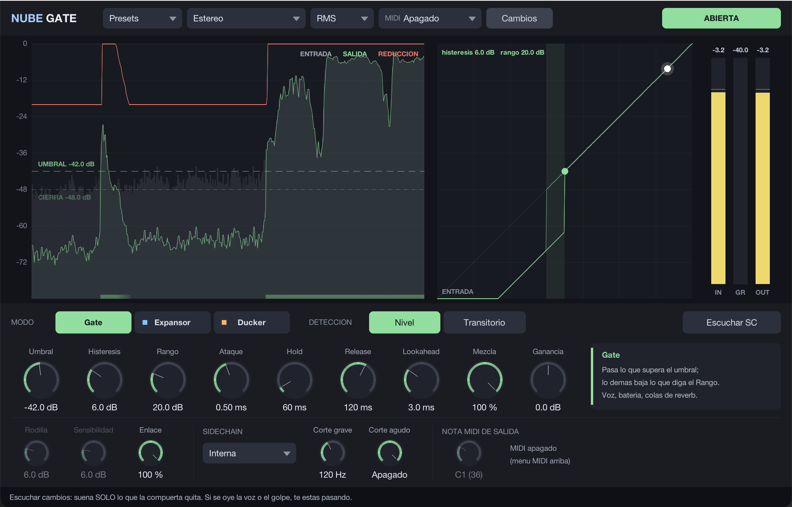

<!-- en -->
# Nube Gate

A free gate / expander / ducker for [REAPER](https://www.reaper.fm), written as a JSFX (macOS / Windows / Linux), part of the
[Nube plugins](https://github.com/KevinMeneses/nube-plugins).




Gate, expander and ducker modes; level detection with hysteresis or **transient detection** (opens on hits even when
the tail stays above the threshold); threshold, hysteresis, range up to ∞, attack, hold, release, ratio and knee;
lookahead with latency compensation; peak/RMS detector, stereo link, stereo / M-S / mid-only / side-only; internal or
external (3/4) sidechain with low/high cut filters; listen to the sidechain or to what gets removed; mix and output
gain; **MIDI out** (one note per hit, velocity from the hit's peak — for drum replacement) and **MIDI in** (notes open
the gate); live graphs and 27 presets. ~0.5 % CPU.

**Install** — with [ReaPack](https://reapack.com): *Extensions → ReaPack → Import repositories*, paste
`https://github.com/KevinMeneses/nube-plugins/raw/main/index.xml`, then install **Nube Gate**. Or copy `nube_gate.jsfx`
into `REAPER/Effects/Nube Gate/` (on macOS `./install.sh` links it). It shows up as **JS: Nube Gate**. The interface is in Spanish.

**How it was made** — designed and built with [Claude Code](https://claude.com/claude-code). Since an AI can't
listen, every feature is verified by rendering test cases inside REAPER and comparing them with the theory
(`tests/run.sh`), plus mouse-driven UI tests (`tests/ui_test.py`).

**License** — GPL-3.0-or-later (see `LICENSE`).

---

## Español
Gate para REAPER (JSFX, macOS/Windows/Linux), hermano de [Nube Comp](https://github.com/KevinMeneses/nube-comp): fácil de
usar y con lo que traen los gates de pago (Pro-G, Drumgate, el gate de las consolas SSL).


- **3 modos**:
  - **Gate**: deja pasar lo que supera el umbral y baja el resto lo que diga el **Rango**.
  - **Expansor**: bajo el umbral baja de a poco según el **ratio** (1:2, 1:4…) con **rodilla**. Limpia sin cortar colas.
  - **Ducker**: al revés; cuando el sidechain supera el umbral, baja la señal (la voz que baja la música o el delay).
- **Detección**:
  - **Nivel**: abre en el umbral y cierra en *umbral − histéresis* (no tiembla cuando el nivel ronda el umbral).
  - **Transitorio**: abre solo con golpes (el nivel salta de repente, con **sensibilidad** en dB) y cierra tras Hold +
    Release aunque la cola siga fuerte. Para acortar caja, clap o toms cuando un gate normal no puede.
- Umbral (−80 a 0 dB), histéresis, **rango** (0 a ∞), ataque (0.01–100 ms), **hold** (0–1 s), release (1 ms–3 s).
- **Lookahead** hasta 10 ms (REAPER compensa la latencia): abre antes del golpe y no se pierde el ataque.
- Detector de **pico** (máximo de los últimos 12–24 ms: lee exacto hasta un tono de 42 Hz, sin temblar) o **RMS**.
- **Enlace estéreo** 0–100 %. **Canales**: estéreo, **Mid/Side**, solo centro o solo lados.
- **Sidechain** interno o externo (canales 3/4) con **corte grave** y **corte agudo** (ej. en la caja, que el bombo no la
  abra; en el kick, que el hi-hat no lo abra). **Escuchar SC** para ajustarlos.
- **Escuchar cambios**: suena solo lo que el gate quita. **Mezcla** (gate paralelo) y **ganancia** de salida.
- **MIDI**:
  - **Salida**: manda una nota en cada golpe (nota elegible, velocidad según el pico: 0 dBFS = 127). Para doblar o
    reemplazar una batería con un sampler o con [Nube Synth](https://github.com/KevinMeneses/nube-synth). Con lookahead
    ≥ 2 ms la nota cae justo en el golpe (sin lookahead llega 2 ms tarde, lo que tarda en medir la velocidad).
  - **Entrada**: las notas MIDI que llegan a la pista abren la compuerta (mientras la nota está apretada + hold).
- Gráfica en vivo (entrada, salida, reducción, franja de **abierta**, líneas de umbral y de cierre), **curva de
  transferencia** con la zona de histéresis y el nivel actual, medidores IN/GR/OUT, indicador **ABIERTA/CERRADA**.
- Ayuda en el pie de la ventana de todo lo que tienes bajo el mouse.

## Instalar

```sh
./install.sh
```

Crea un enlace en `~/Library/Application Support/REAPER/Effects/Nube Gate/`. En REAPER aparece como
**JS: Nube Gate** en el navegador de FX. Si cambias el código, vuelve a insertar el FX.

## Cómo se usa

| Acción | Cómo |
|---|---|
| Umbral | Perilla, o **arrastra arriba/abajo en la gráfica** (línea punteada = abre, la más tenue = cierra) |
| Rango | Perilla, o **rueda del mouse sobre la gráfica** |
| En la curva | Arrastra **izquierda/derecha = umbral**, **arriba/abajo = rango**, rueda = histéresis (ratio en el expansor) |
| Perillas | Arrastra arriba/abajo o usa la rueda; **Shift** = fino; **doble clic** = valor por defecto |
| Presets | Botón *Presets* o clic derecho en la gráfica |
| Reiniciar máximos | Clic en los medidores |

La segunda perilla cambia según el modo: **Histéresis** (gate/ducker por nivel), **Sensibilidad** (transitorio) o
**Ratio** (expansor). La que no está arriba queda abajo, en la fila chica.

### Receta: ajustar un gate en 20 segundos

1. Elige un preset parecido.
2. Prende **Escuchar cambios** y baja el **Umbral** hasta que empieces a oír la voz o el golpe; súbelo un poco.
3. Apaga *Escuchar cambios*. Si corta finales de palabra, sube **Hold**; si tiembla, sube **Histéresis**.
4. Si suena "cortado", baja el **Rango** (10–20 dB suena natural) o pasa a **Expansor**.

### Sidechain (el kick abre el bajo, o la voz baja la música)

1. En la pista que se procesa pon Nube Gate y elige *Kick abre el bajo / pad (3/4)* o *Ducker: la voz baja la música (3/4)*.
2. En la pista que manda (kick o voz), crea un envío hacia esa pista en los canales **3/4** (la pista necesita 4 canales;
   si no, el pie de la ventana avisa).

### Disparar MIDI (doblar el kick con un sample)

1. En la pista del kick pon Nube Gate con el preset *Disparo MIDI: kick a nota 36* (rango 0: no le cambia el sonido).
2. Crea una pista con un sampler (o Nube Synth) y un envío **solo MIDI** desde la del kick.

## Presets

| Preset | Qué hace |
|---|---|
| Voz Tonor - Gate (Nube baja) | Igual al ReaGate "Voz · Gate" de las cadenas *Voz Tonor* (medido: ±0.1 dB): −45.1 dB, 1/79/150 ms, pre-apertura 5 ms; su Dry −15.1 se suma a la señal, por eso va con rango ∞, mezcla 85 % y +1.4 dB. Ojo: con el ruido del Tonor (picos de −44.6 dB) **no cierra nunca**, igual que el ReaGate; para limpiar usa el siguiente |
| Voz: limpiar entre frases (Expansor) | Expansor 1:2, −42 dB, rodilla 8, rango 12, SC corte 100 Hz |
| Voz rap: gate preciso | RMS, −42 dB, histéresis 6, rango 20, 0.5/60/120 ms, lookahead 3, SC corte 120 Hz. En la voz seca de Nube baja: frases intactas (0.0 dB) y el ruido entre frases −19 dB |
| Kick apretado | −24 dB, rango 40, 0.1/30/80 ms, SC corte agudo 250 Hz (que el hi-hat no lo abra) |
| Caja sin hi-hat | −24 dB, histéresis 6, rango 30, SC 150 Hz – 4 kHz |
| Toms | −30 dB, rango 30, hold 100, release 300, SC 60 Hz – 2 kHz |
| Hi-hat corto | −30 dB, rango 24, 0.05/10/40 ms, SC corte 5 kHz |
| Batería: acortar colas (Transitorio) | Por golpes, rango 12, hold 40, release 60 (como el `claude_cola_corta` de la caja) |
| 808: cortar la cola | −30 dB, rango 40, hold 150, release 120, SC corte agudo 200 Hz |
| Reverb gateada (80s) | −30 dB, rango ∞, hold 250, release 15 ms |
| Ducker: la voz baja la música (3/4) | Ducker externo, −36 dB, −6 dB, 10/100/300 ms |
| Kick abre el bajo / pad (3/4) | Gate externo, −30 dB, rango 40, hold 60, release 150 |
| Guitarra / amp: ruido (Expansor) | Expansor 1:3, −50 dB, rodilla 10, rango 20 |
| Disparo MIDI: kick a nota 36 | Por golpes, rango 0 (no toca el audio), lookahead 3, MIDI de salida |

## Estructura

- `nube_gate.jsfx`: el plugin (DSP + interfaz).
- `tests/run.sh`: renderiza 55 casos en una pestaña temporal de REAPER y los compara con la teoría (95 chequeos, más que
  ningún render tenga NaN ni quede desalineado): curva estática (gate, rango 15/40/∞, expansor con ratio, rango y
  rodilla, ducker), histéresis sobre una rampa de 10 dB/s (cierra en −46 y abre en −40, sin rebotes), 50 Hz cerca del
  umbral sin temblar, ataque/release lineales en dB, hold, lookahead (y que la latencia quede compensada), sidechain
  externo, filtros y escuchar SC, escuchar cambios, mezcla, ganancia, enlace, M/S, RMS, transitorios contra nivel,
  MIDI de salida (6 notas en su lugar ±1 ms, velocidad, número, nota apagada) con `tests/midi_probe.jsfx`, MIDI de
  entrada, los 27 presets y una voz real (preset 3: frases intactas y ruido −19 dB; preset 1 contra el ReaGate de la cadena).
- `tests/ui_demo.lua` / `tests/ui_close.lua` / `tests/reopen.sh`: abren y cierran una pestaña de demo con audio.
- `tests/ui_test.py` + `tests/ui.py` + `tests/ui_dump.lua` + `tests/scroll.swift`: pruebas de la interfaz con el mouse (17 chequeos: modos, detección, perillas, gráfica, curva, rueda, botones)
  (`cliclick`). Mueven el mouse de verdad: no correrlas mientras se usa REAPER.
- `tests/perf.lua`: CPU en el peor caso.

## Detalles técnicos

- Detector de pico: máximo deslizante con dos ventanas de 12 ms (la actual y la anterior), sin caídas entre picos; un
  detector con caída exponencial leía hasta 1.4 dB de menos entre picos y cerraba antes de tiempo.
- Gate/ducker: estado abierta/cerrada con histéresis y hold; la apertura va de 0 a 1 en *Ataque* ms y vuelve en
  *Release* ms, y la ganancia es lineal en dB (−Rango·(1 − apertura)). Con rango ∞ la rampa llega a −60 dB y corta a cero.
- Expansor: reducción `(ratio−1)·(umbral−nivel)` con rodilla cuadrática y tope en el rango, suavizada en dB.
- Transitorios: envolvente rápida (0.5/5 ms) contra lenta (20/150 ms); un golpe es el flanco de subida y bloquea 20 ms
  (la onda del mismo golpe no vuelve a disparar).
- MIDI de salida: la nota sale después de medir el pico del golpe (máx(lookahead, 2 ms)) con `pdc_midi`, así que con
  lookahead queda alineada.
- Trampas de EEL2 (las mismas del EQ/Comp): variables sin distinción de mayúsculas, nada de notación científica, y la
  interfaz corre en otro hilo (pide recalcular con `upd = 1` y el audio lo hace en `@block`). Al dar play las ganancias
  saltan a su valor (no se deslizan desde el anterior).

Nota sobre las pruebas: necesitan REAPER y Python con numpy, scipy y soundfile (`NUBE_PY=/ruta/a/python tests/run.sh`).
Los casos de voz real usan una grabación propia y la cadena *Voz Tonor 1*, que no están en el repo; sin ellas se saltan.
